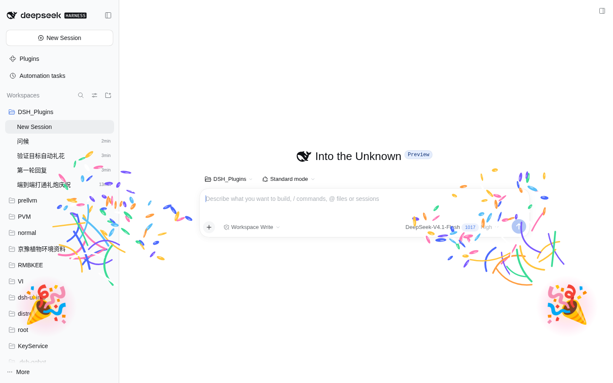

# dsh-cheerful

> ⚠️ **V0.1-Unstable**：实验性版本，接口与行为可能随时变动，建议只在个人/测试环境使用。

给 DeepSeek Harness（dsh）加一个 **cheer** 工具：模型一调用，Web 界面左右两侧的礼炮就同时向中间喷出彩带。纯画面，不显示任何文字。

[](https://github.com/Mika-Maki/dsh-cheerful/actions/workflows/ci.yml)

## 效果

- 左右两个 🎉 礼炮 emoji（弹入过冲 + 后坐 + 暖色辉光，右侧镜像朝内）
- 每侧 30–70 条彩带 / 长流苏，重力 + 空气阻力 + 摆动 + 自旋
- CPU 侧 canvas 单层绘制，`pointer-events: none`，不挡任何点击
- 不渲染居中文字，只留礼炮与彩带
- `prefers-reduced-motion: reduce` 下不播放粒子
- 历史会话回放不会重放礼炮，只有实时调用才触发
- 工具卡上有「再放一次」按钮，本地重播

## 预览



## 安装

任选一种（都会把 bundle 追加进 profile 的 `dsh.profile.bundles`）：

```sh
# GitHub（推荐，无需发布 npm）
dsh plugin --profile web add github:Mika-Maki/dsh-cheerful

# npm（发布后可用）
dsh plugin --profile web add dsh-cheerful

# 本地 tarball（npm pack 产物）
dsh plugin --profile web add file:/path/to/dsh-cheerful-0.1.0.tgz

# 本地目录开发
dsh plugin --profile web add "link:$PWD"
```

卸载：`dsh plugin --profile web remove dsh-cheerful`。

## 配置

### Host 侧（profile patch）

`cheer` 工具在模型没给参数时的默认值走插件 Config，可在 profile 的 `cordis.patch.yml` 里覆盖：

```yaml
- id: cheerful
  name: dsh-cheerful
  config:
    defaultSide: left        # both | left | right
    defaultIntensity: 3      # 1..3
```

### 客户端（设置 → 通用 → 自动礼花）

所有触发参数都在界面里可调，并持久化到 `localStorage`（键 `dsh-cheerful/settings`）：

| 设置 | 默认 | 说明 |
|---|---|---|
| 自动礼花 | 开 | 总开关 |
| 最少步数 | 2 | 单轮走满多少步才自动放 |
| 单轮礼炮强度 | 2 | 多步触发时的强度 |
| 目标完成礼炮强度 | 3 | goal 完成触发时的强度 |

也可以在控制台直接改：

```js
window.__dshCheerful.setSettings({ minSteps: 4, turnIntensity: 3 })
window.__dshCheerful.getSettings()
window.__dshCheerful.resetSettings()
```

## 自动礼花规则

- **目标完成**：会话的 goal 投影进入 `complete` 时放一次。
- **单轮多步**：一次提问里 agent 走了「最少步数」及以上，这一轮结束时放一次；单步的一问一答不会放。
- **每轮最多一次**：目标完成和单轮多步共用「当轮」配额；下一轮开始时配额重置。
- 页面在后台时不放；1 秒防抖；只看「本轮从运行到结束」的真实变化，刷新/回放不会误触发。

## 工具参数

| 参数 | 类型 | 说明 |
|---|---|---|
| `side` | `both` \| `left` \| `right` | 可选，默认取 Config 的 `defaultSide` |
| `intensity` | 1–3 | 可选，默认取 Config 的 `defaultIntensity` |

## 结构

```
package.json          dsh.bundle.patch + dsh.client(web) + Config
cordis.patch.yml      insert 一行 id: cheerful
lib/index.js          Host 半边：defineTool 注册 cheer（参数走 Config）
lib/client.js         浏览器半边：shell.overlay 浮层
                      + tool.call.toolview 工具卡
                      + settings.general.item 自动礼花设置
                      + conversation.session.header.actions 自动礼花观察者
test/contract.test.mjs 槽位注册 / 参数归一化 / 设置 / 步数 / 冷却
.github/workflows/ci.yml  npm test + node --check
```

## 开发

```sh
npm test        # 契约测试（无依赖，Node 直接跑）
npm run check   # 语法检查 + 契约测试
npm pack        # 生成可分发 tarball
```

浏览器半边是手写 `window.__ModuleLoader__.load` 包，改完不需要构建；Host 半边改动需要重启 `dsh web`。

## 约定

- 插件名 `cheerful` 必须与 `cordis.patch.yml` 的 `id` 一致。
- 不写自定义会话事件，避免影响 session resume。
- 浏览器侧只用标准 slot / 标准 hooks，不 import 其他插件的内部模块。